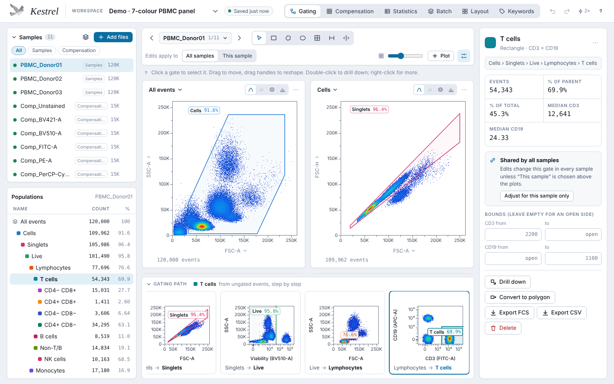
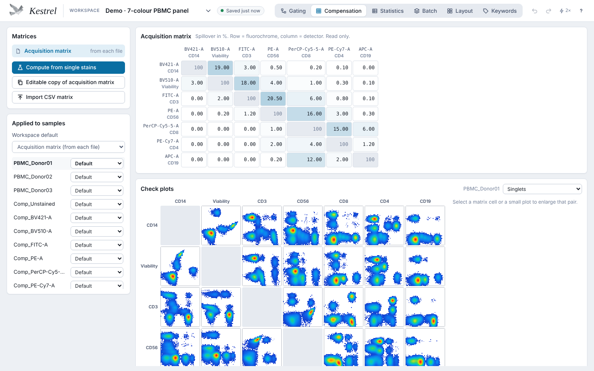
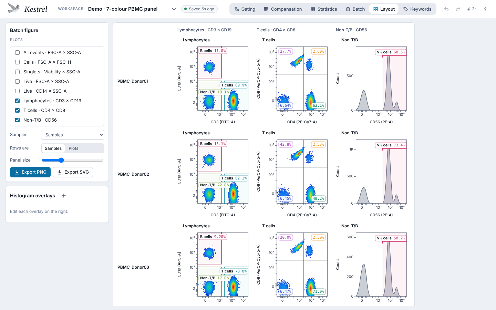
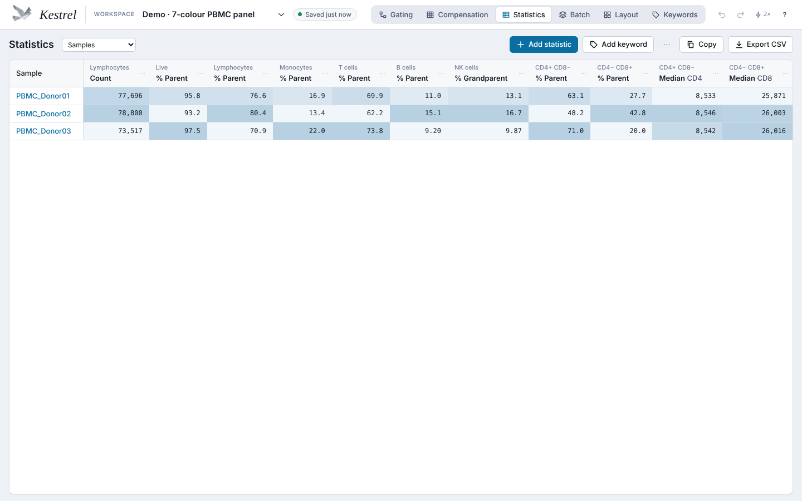
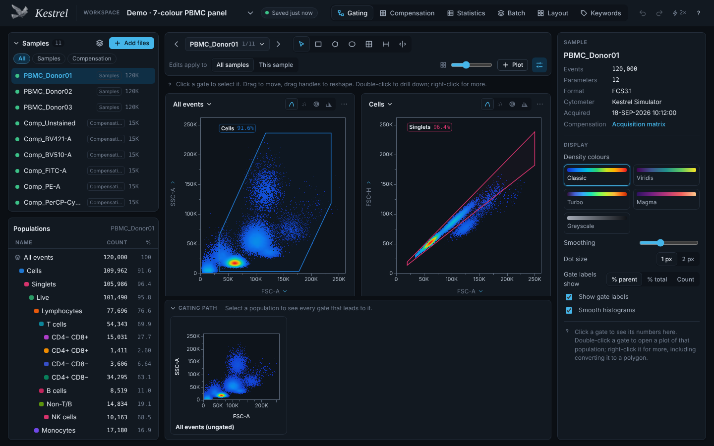

# Kestrel

**Free, open-source flow cytometry analysis that runs in your browser.**

Kestrel reads FCS files, compensates them, scales them (Logicle, Hyperlog, arcsinh, log, linear), and lets you gate them interactively. You can then build statistics tables and batch figures, and save the whole analysis as a workflow template to reuse on the next experiment. The app is a single HTML file of about 670 KB with no server, account, or installation. Your data never leaves your computer.



- **Lightweight.** One self-contained file. Open `dist/kestrel.html` in a browser, put it on any static host, or use GitHub Pages.
- **Fast.** Computation runs in a pool of background threads, one per core (up to 8). On a modest 2-core machine, a 1-million-event file loads in about 0.5 s, and all plots and populations update in about 0.6 s. Five million events also work.
- **Familiar.** The workflow follows FlowJo, FCS Express and OMIQ: a population tree, gates drawn on plots, a shared gating strategy with per-sample adjustments, a statistics table and layouts.
- **Interoperable.** Gates import and export as ISAC Gating-ML 2.0. Populations export as FCS 3.1 or CSV. Matrices import and export as CSV.
- **Validated.** All 49 gates of the Gating-ML 2.0 compliance suite match the published results event for event (see [Validation](#validation)).

## Try it

1. Download `dist/kestrel.html` from this repository (or from the Releases page) and open it in Chrome, Edge, Firefox or Safari.
2. A simulated 7-colour PBMC experiment opens as a demo. It has three donors, an unstained control and seven single-stain bead controls.
3. Drop your own `.fcs` files onto the window to start a new workspace.

If GitHub Pages is enabled for the repository, the included workflow publishes the app at `https://<user>.github.io/<repository>/`.

The page loads three Google Fonts and makes no other network requests. Offline, it falls back to system fonts.

## Open workspace files by double-clicking (Windows)

Kestrel has no installer and no file association of its own — by default, opening a saved `.kestrel.json` workspace means opening `kestrel.html` first and then dropping the file onto the window. A small included script lets Windows do the second part for you: double-click a `.kestrel.json` file and it opens straight into Kestrel, the same as a drag-and-drop would.

This needs [Node.js](https://nodejs.org) installed and this repository present on disk (it's what actually reads the file and hands it to the browser — a web page can't read an arbitrary local file on its own). One-time setup:

1. Right-click any `.kestrel.json` file → **Open with** → **Choose another app**.
2. Choose **More apps** → **Look for another app on this PC**. If the file picker only shows `.exe` files, switch its filter (bottom-right of the dialog) to **All files**.
3. Browse to `scripts\open-kestrel-workspace.bat` inside this repository.
4. Tick **Always use this app to open .kestrel.json files**, or leave it unticked to be asked each time — either way, Windows is only associating the exact `.kestrel.json` extension, not every `.json` file.

After that, double-clicking a workspace opens a browser tab with it loaded:

- **Its data files load too.** A workspace file lists its samples' data files by name but doesn't contain them, so the helper looks for them in the workspace's own folder and its immediate subfolders (names match regardless of case) and loads whatever it finds.
- **Anything it can't find, it asks for.** A *Find this workspace's data files* dialog lists the missing ones; choose the folder they're in (its subfolders are searched too) and they load. The dialog closes itself once nothing is missing, whether the files came from the folder you picked, *Choose files…*, or a drag-and-drop. The same dialog is available later from the *Find them…* link in the Samples panel, and comes up whenever you drop a workspace file whose data isn't loaded.
- **Nothing lingers.** The helper's console window opens minimized and closes by itself as soon as the browser has the files; if something goes wrong (Node.js missing, the file moved), you get a message box instead of a window waiting for a key press. Nothing is installed or left running.

The helper prints the page's URL in that (minimized) window, in case your default browser doesn't launch — paste it into a browser yourself. See `scripts/open-workspace.mjs` for how it works, or to adapt it for another OS (swap the `.bat` for a `.command`/shell script on macOS and Linux — the Node script itself already runs on any of them).

If you move or rename this folder, redo step 3 pointing at the new location.

## Features

| Area | What you get |
| --- | --- |
| **Data** | FCS 2.0, 3.0, 3.1 and 3.2. Integer, float, double and ASCII data in any byte order, including mixed per-parameter types (`$PnDATATYPE`). Bit masks, `$PnE` log decoding, `$PnG` gain, supplemental TEXT and files with several data sets. CSV/TSV event tables are also read. Files are cached in the browser, so a reopened workspace comes back with its data. |
| **Compensation** | Acquisition matrix from each file (`$SPILLOVER`, `SPILL`). Compute a matrix from single-stain controls (median-based, with an unstained control or internal negatives) and edit it cell by cell. Matrices import and export as CSV. Each sample gets its own matrix assignment, and an N×N check-plot grid shows the result. Only parameters present in the workspace's files are shown. |
| **Scales** | Linear, log, Logicle (biexponential, with automatic width from the data), Hyperlog and arcsinh. Scales are set per channel and shared by every plot and sample. Ratio parameters such as `FSC-A / FSC-H` behave like any other channel. Each parameter can also be given (or given a different) display label from the axis picker's rename button — useful when the FCS file's own `$PnS` field is blank or wrong, e.g. naming `FITC-A` "CD4". |
| **Gating** | Rectangle, polygon, ellipse, quadrant, range and split gates, plus Boolean AND / OR / NOT gates, in a hierarchy. Drag to move or reshape. Double-click a gate to drill down into its population. Right-click to convert it to a polygon, recolour it, adjust it for one sample, apply one sample's adjusted gate to a chosen set of other samples at once, or export its events. Undo and redo cover every edit. |
| **Backgating and batch** | A gating-path strip along the bottom of the Gating view shows every step from the ungated FSC-A × SSC-A plot to the selected population, each with its gate and frequency. The Batch tab shows every gating plot for every sample, with that sample's gates and frequencies; click one to open it. |
| **Plots** | Pseudocolour density, dot, contour and histogram plots, with five colour maps. Click an axis title to choose its parameter and scale. Dot size is typeable and can be set per plot, overriding the default. Concatenate (pool) any set of samples into one plot of any type. Plots export as PNG or vector SVG. |
| **Statistics** | Count; % of parent, grandparent and total; median; mean; geometric mean; SD; CV; robust SD and CV; mode; min; max; and any percentile. FCS keywords can be added as columns. Export as CSV or copy into a spreadsheet. |
| **Layouts** | Batch figures (samples × plots grids) and histogram overlays across samples, exported as PNG or SVG. Plot titles and axis labels can be toggled off per panel for a tighter grid. A gating-hierarchy panel ("Add gating hierarchy") shows every population under a chosen root with configurable columns (count, % parent, % grandparent, % total), one per sample, also visible in Batch. |
| **Samples** | Groups, grouping by keyword, a keyword browser, and a comparison of keywords across samples. |
| **Saving** | Autosave to the browser on every change and view switch, plus a workspace library. Workspaces save as `.kestrel.json` files and analyses as `.template.json` workflow templates. Gates also save as Gating-ML 2.0. On Windows, a `.kestrel.json` file can be set to open in Kestrel on double-click; see [Open workspace files by double-clicking](#open-workspace-files-by-double-clicking-windows). |
| **Automation** | A command-line batch runner that applies a template to a folder of FCS files, and a JavaScript library for the analysis core. See [Command line and library](#command-line-and-library). |

<table>
<tr>
<td></td>
<td></td>
</tr>
<tr>
<td></td>
<td></td>
</tr>
</table>

## Workflow templates

A template captures an analysis without its data: scales, compensation choices and matrices, ratio parameters, the gating hierarchy, plots, the statistics table and layouts. To reuse one:

- **In the app:** open the workspace menu (the arrow next to the workspace name) and choose *Apply template to these samples*, or drop a `.template.json` file onto the window. The template is applied to every sample in the workspace.
- **Headless:** run `node scripts/kestrel-batch.mjs --template panel.template.json data/ > stats.csv` to get the same statistics table the app would produce.

`examples/` contains a template and the matching Gating-ML for the demo panel. The format is described in [docs/workflow-templates.md](docs/workflow-templates.md).

## Validation

| Check | Result | Reproduce |
| --- | --- | --- |
| ISAC Gating-ML 2.0 compliance suite: rectangle, polygon, ellipse, quadrant (2-D and 3-D), Boolean, ratio, and all scale types, with and without compensation | **49 of 49** gates match the reference results event for event | `npm run compliance` |
| Gating-ML written by Kestrel, evaluated by [FlowKit](https://github.com/whitews/FlowKit) | Same event counts for all 13 demo gates | `scripts/flowkit-crosscheck.py` |
| App statistics export vs headless batch runner on the same files | Identical CSV | `npm run e2e` |
| Spillover computed from simulated single-stain beads | FITC→PE 24.01 % vs 24 % simulated | `npm test` |
| Logicle, Hyperlog, FCS reader/writer, compensation, statistics, Gating-ML round trips | 45 unit tests | `npm test` |
| Drawing, editing, drill-down, autosave and exports in a real browser | 60 end-to-end checks (Playwright) | `npm run e2e` |

Details and method are in [docs/validation.md](docs/validation.md).

## Performance

These numbers come from headless Chromium on a 2-core Xeon virtual machine with 8 GB RAM (`npm run perf`). Machines with more cores are faster.

| Events in one file | Load (parse + compensate) | All 8 plots and 13 populations | Change a Logicle width and redraw |
| ---: | ---: | ---: | ---: |
| 1,000,000 | 0.54 s | 0.56 s | 0.36 s |
| 5,000,000 | 1.0 s | 1.8 s | 0.31 s |

The headless batch runner processes the 11 demo files (480,000 events) in 0.7 s.

## Command line and library

```sh
npm install                 # only needed for building and tests
node scripts/kestrel-batch.mjs -t examples/pbmc-7colour.template.json demo-data/ -o stats.csv
npm run demo-data           # writes the simulated demo experiment as FCS files to demo-data/
```

The analysis core has no dependencies and runs in Node 18+ and in browsers:

```js
import fs from 'node:fs';
import { parseFCS, makeTransform, Engine, runTemplate } from './src/index.js';

const fcs = parseFCS(fs.readFileSync('sample.fcs'));
console.log(fcs.nEvents, fcs.channels.map((c) => c.label || c.name));

const logicle = makeTransform({ type: 'logicle', T: 262144, W: 0.5, M: 4.5, A: 0 });
logicle.scale(1000); // position on a 0..1 display axis

const template = JSON.parse(fs.readFileSync('panel.template.json', 'utf8'));
const { header, rows } = runTemplate(template, [{ name: 'sample.fcs', buffer: fs.readFileSync('sample.fcs') }]);
```

## Build from source

```sh
npm install
npm run build        # dist/kestrel.html (and dist/artifact.html, a body-only variant)
npm run dev          # rebuild on every change
npm test             # unit tests (node:test)
npx playwright install chromium
npm run e2e          # end-to-end tests in a real browser
npm run compliance   # Gating-ML 2.0 compliance (downloads the reference files once)
```

The UI uses [Preact](https://preactjs.com) and is bundled with [esbuild](https://esbuild.github.io). There is no framework runtime or CSS toolchain beyond that. [docs/architecture.md](docs/architecture.md) explains how the pieces fit together.

```
src/core/     FCS reader/writer, transforms, compensation, gates, Gating-ML, statistics (no dependencies)
src/engine/   computation engine run in Web Workers; headless batch runner
src/ui/       Preact interface: state, plots, views
scripts/      build, batch CLI, compliance check, examples, screenshots
test/  e2e/   unit tests and Playwright end-to-end tests
examples/     a workflow template and Gating-ML for the demo panel
```

## Limitations and roadmap

These are not available yet. Contributions are welcome.

- Clustering and dimensionality reduction (UMAP, t-SNE, FlowSOM)
- Spectral unmixing. Data already unmixed by the instrument software can be analysed.
- FlowJo `.wsp` import. Gating-ML 2.0 is the supported exchange format.
- One compensation matrix per sample. A Gating-ML file that uses different matrices for different gates on the same sample cannot be represented.
- Gates have one or two dimensions. Gating-ML quadrant gates with three dimensions are imported as Boolean combinations of simpler gates.
- Very large files are limited by browser memory. 5 million events per file has been tested.

Kestrel is research software and is not intended for clinical diagnostic use.

## How to cite

If Kestrel contributed to your analysis, please cite it:

> Carlino, M.J. (2026). *Kestrel: free, browser-based flow cytometry analysis* (version 0.1.1) [Computer software]. https://github.com/maxjcarlino/Kestrel

```bibtex
@software{kestrel,
  author  = {Carlino, Maximillian J.},
  title   = {Kestrel: free, browser-based flow cytometry analysis},
  year    = {2026},
  version = {0.1.1},
  url     = {https://github.com/maxjcarlino/Kestrel}
}
```

A machine-readable [CITATION.cff](CITATION.cff) is also included, which GitHub uses to show a "Cite this repository" button on the repo page and to populate reference managers (Zotero, EndNote) that support it.

## Contributing

Bug reports, test files that read incorrectly, and pull requests are all welcome. See [CONTRIBUTING.md](CONTRIBUTING.md).

## Acknowledgements

- The Logicle scale follows the reference implementation published by Moore and Parks, *Cytometry A* 81A:273 (2012), and Parks, Roederer and Moore, *Cytometry A* 69A:541 (2006).
- Gate and transform semantics follow the ISAC Gating-ML 2.0 standard (Spidlen et al., *Cytometry A* 87A:683, 2015).
- The compliance reference data come from the Gating-ML 2.0 test suite (J. Spidlen and N. Gopalakrishnan), as distributed with [FlowKit](https://github.com/whitews/FlowKit). The data are downloaded at test time and not redistributed here.
- The Hyperlog constants were checked against [flowutils](https://github.com/whitews/flowutils).

## License

[MIT](LICENSE). You are free to use, modify and redistribute Kestrel, including in commercial and closed-source work.
